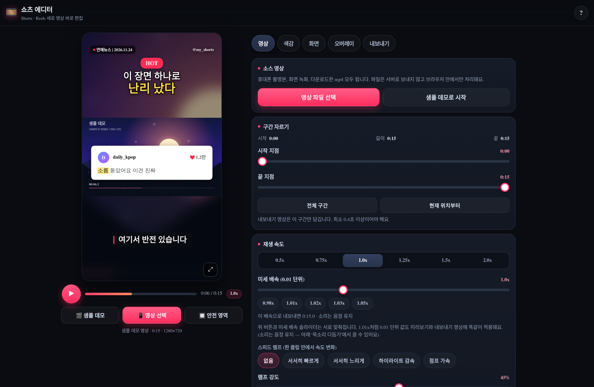
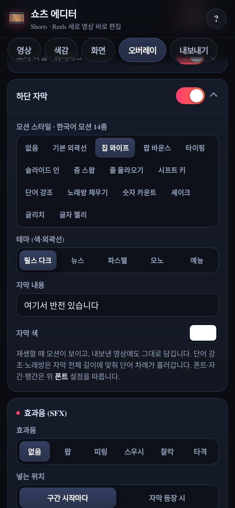
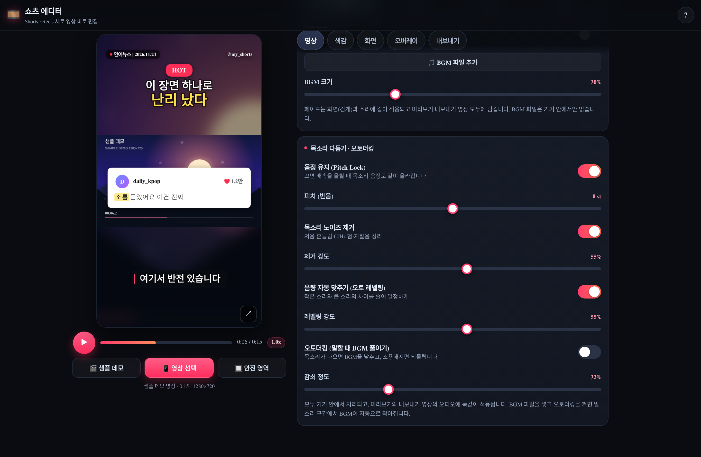

# 🎬 SOCUT — 쇼츠 · 릴스 제작 도구 세트

한국어 숏폼(유튜브 쇼츠 · 인스타 릴스)을 만드는 도구를 한 저장소에 모았습니다.

| 구성 | 무엇을 하나 | 바로 가기 |
|---|---|---|
| 🎞️ **쇼츠 에디터 (웹앱)** | 브라우저에서 바로 열어 영상 편집·자막·오버레이·내보내기. 설치·로그인·외부 요청 0 | **<https://misssu33.github.io/SOCUT/>** |
| 🛠️ **shorts-pro 스킬** | PC에서 FFmpeg으로 자막·모션·오디오까지 끝내고 1080×1920 MP4로 뽑기 (Claude Code / Codex CLI) | [shorts-pro-skill/](shorts-pro-skill/) · [zip](shorts-pro-skill.zip) · [사용방법 PDF](shorts-pro-skill-사용방법.pdf) |
| 🎨 **motion-library** | 한국어 자막 모션 15종 · 테마 5종 라이브러리 (Canvas 미리보기 + MP4 렌더) | [motion-library/](motion-library/) · [묶음 zip](motion-library-bundle.zip) |

세 가지는 따로 써도 되고 이어서 써도 됩니다. 웹앱에서 편집한 설정은 `shorts-job.json` 한 파일로 저장되어
PC의 `motion-library/render_mp4.py` 로 그대로 MP4에 구워집니다.

---

# 1. 🎞️ 쇼츠 에디터 — Shorts · Reels 세로 영상 편집 웹앱

`index.html` 파일 **하나**로 동작하는 무료 쇼츠/릴스 편집기입니다.
서버도, 회원가입도, 설치도, 외부 CDN도 없습니다. 영상은 기기 밖으로 나가지 않고 브라우저 안에서만 처리됩니다.







---

## 30초 시작하기

1. **<https://misssu33.github.io/SOCUT/>** 를 Chrome(또는 삼성 인터넷)으로 엽니다. (인터넷 없이 쓰려면 `shorts-editor-deploy.zip`을 풀어 나오는 `index.html`을 열어도 똑같습니다)
2. **🎬 샘플 데모**를 눌러 영상 없이 모든 기능을 먼저 확인합니다.
3. **📱 영상 선택**으로 편집할 영상을 불러옵니다.
4. 아래 탭에서 조정합니다 — **영상 · 색감 · 화면 · 오버레이 · 내보내기**.
5. **내보내기** 탭 → 화질 선택 → **영상 내보내기** → `.webm` 파일이 저장됩니다.

> 휴대폰에서는 `index.html` 파일을 카카오톡 "나에게 보내기"나 드라이브로 옮긴 뒤, 파일을 **Chrome / 삼성 인터넷**으로 열면 됩니다. (아이폰은 Chrome 앱 권장)
> 웹에 올리려면 GitHub Pages, Netlify Drop, Cloudflare Pages 어디든 `index.html`만 올리면 됩니다. 빌드 과정이 없습니다.

---

## 기능

### 1. 영상 불러오기 · 9:16 프리뷰
- 로컬 영상 파일 선택 (mp4 / mov / webm / m4v 등 브라우저가 읽는 형식)
- 9:16 쇼츠·릴스 프리뷰 캔버스, **16:9 가로 전환**
- **안전 영역 가이드**: 쇼츠/릴스 앱 UI에 가려지는 상·하단 영역 표시 (미리보기 전용, 저장 영상에는 들어가지 않음)
- **⤢ 크게 보기**: 프리뷰 오른쪽 아래 버튼으로 전체 화면 확대 (작은 휴대폰에서 자막·오버레이 확인용, Esc 또는 화면 탭으로 복귀)
- 샘플 데모: 캔버스 애니메이션으로 만든 15초 테스트 영상 — 영상 파일 없이도 모든 기능 확인 가능

### 2. 색감 / 필터
- 밝기 40~160%, 대비 40~180%, 채도 0~200%, 색온도(웜/쿨) -40~+40°
- 프리셋 5종: **기본 · 선명하게 · 시네마 · 쿨톤 · 웜톤**

### 3. 좌우 반전 (미러링)
- 셀카 영상이 거울처럼 보일 때 한 번에 뒤집기

### 4. 재생 속도
- **0.5x · 0.75x · 1.0x · 1.25x · 1.5x · 2.0x** 굵은 버튼
- **미세 배속 슬라이더 0.50x~2.00x (0.01 단위)** — 1.01x·1.02x·1.03x처럼 아주 조금만 바꿀 때
- 빠른 선택 칩 **0.98x · 1.01x · 1.02x · 1.03x · 1.05x**
- 굵은 버튼과 슬라이더는 서로 맞춰집니다. 0.01 단위 값이 `1.02x`처럼 그대로 표시되고, 미리보기·저장 영상·내보낼 길이 계산(구간 ÷ 배속)에 똑같이 적용됩니다 (소리는 음정 유지)

### 4-1. 스피드 램프 (한 클립 안에서 속도 변화)
- 프리셋 5종: **없음 · 서서히 빠르게 · 서서히 느리게 · 하이라이트 감속(빠→느→빠) · 점프 가속(느→빠→느)**
- **램프 강도 0~80%**(기본 45% → 1.0x 기준 0.55x~1.45x), **램프 구간 30~100%**(클립의 어느 부분에서 변할지)
- 미리보기 재생 중에도 배속이 서서히 변하고, **내보낸 영상은 같은 시간 적분(`rampTime`)으로 계산**되어 길이·자막 타이밍이 미리보기와 일치합니다
- 힌트에 `서서히 빠르게 · 0.55x ~ 1.45x · 구간 100% · 내보낼 길이 0:16.2`처럼 실제 속도 범위와 결과 길이가 표시됩니다

### 5. 자동 컷편집 (무음 자동 제거)
- 올린 영상의 소리를 브라우저에서 분석(Web Audio `decodeAudioData`)해 **말이 없는 구간을 찾아 건너뜀**
- **무음 기준 -60~-20 dB**, **최소 무음 길이 0.2~1.5초** 조절, **무음 분석** 버튼
- 결과에 `무음 3곳 · 4.12초 제거 → 남는 길이 0:03.9 (원본 0:08.0)`처럼 몇 곳·몇 초가 잘렸는지 표시
- 재생할 때도 무음 구간을 만나면 다음 대사로 건너뛰고, **내보낸 영상은 남는 구간만 이어 붙어** 나옵니다
- 샘플 데모에는 소리가 없어 분석할 수 없습니다(영상 필요)

### 6. 오디오 · 페이드 · BGM
- **원본 소리 크기 0~150%**
- **페이드 인 / 페이드 아웃** (없음 · 0.3초 · 0.5초 · 1.0초) — 소리와 화면(검게)에 같이 적용
- **BGM 파일 추가** (기기 안 오디오 파일, 서버 전송 없음) + **BGM 크기 0~100%**, 반복 재생
- 모두 미리보기와 내보낸 영상에 똑같이 적용

### 6-1. 음정 유지(Pitch Lock) · 피치(반음)
- **음정 유지** 스위치(기본 켜짐) — 끄면 배속을 올릴 때 목소리도 같이 올라갑니다 (`preservesPitch`)
- **피치 -12~+12반음** 슬라이더 — 길이는 그대로 두고 음정만 옮깁니다. +12반음이면 440Hz 톤이 880Hz로 올라갑니다(AudioWorklet 피치 시프터로 미리보기·내보내기 동일 적용)
- 힌트가 `음정도 배속을 따라감` / `음정 유지 +2반음`처럼 현재 상태를 알려 줍니다

### 6-2. 목소리 노이즈 제거
- 스위치 + **제거 강도 0~100%** (기본 55%)
- 처리: 고역통과 70~120Hz(저역 흔들림·험) → **60Hz 노치**(전원 험) → 고역 셸프 -9dB(치찰음·히스)
- 저음 험이 섞인 녹음에서 60Hz 성분이 실제로 20배 이상 줄고, 목소리 대역은 거의 그대로입니다(테스트 수치 아래 참고)

### 6-3. 음량 자동 맞추기 (오토 레벨링)
- 스위치 + **레벨링 강도 0~100%** — 작은 소리는 올리고 큰 소리는 내려 일정한 음량으로
- 처리: RMS 게인 라이딩(AudioWorklet AGC) → 컴프레서 → 리미터. 조용한 구간과 큰 구간의 차이가 약 27배 → 3~5배로 줄어듭니다

### 6-4. 오토더킹 (말할 때 BGM 줄이기)
- 스위치 + **감쇠 정도 10~90%** (기본 32%)
- 목소리 에너지를 실시간(`AnalyserNode`) 감지해 말하는 동안 BGM만 낮추고, 조용해지면 부드럽게 되돌립니다(공격 50ms / 복귀 280ms)
- 미리보기와 내보낸 영상 모두 동작하고, 말소리 자체는 줄지 않습니다

### 7. 효과음 (SFX)
- 브라우저에서 직접 합성하는 내장 효과음 6종: **없음 · 팝 · 띠링 · 스우시 · 찰칵 · 타격** (외부 파일 0개)
- 넣는 위치: **구간 시작마다**(자동 컷으로 나뉜 컷마다) / **자막 등장 시**
- **효과음 크기 0~100%**, **🔊 미리 듣기** 버튼, 내보낸 영상 소리에 함께 섞임

### 8. 확대 · 위치 · 배경
- 확대 **100~250%**, 좌우/위아래 이동 **-50~+50%**
- **배경 블러 채우기**: 16:9 가로 영상을 9:16 프레임에 넣을 때 위아래를 같은 영상의 블러로 채움

### 9. 구간 자르기
- 시작/끝 슬라이더(0.05초 단위), 전체 구간·현재 위치부터 버튼
- 저장 영상은 이 구간만 담김 (최소 0.4초)

### 10. 쇼츠 오버레이 4종 (캔버스에 직접 렌더링)
| 오버레이 | 설정 |
|---|---|
| **상단 제목 배지** | 배지 텍스트·배지 색, 흰색 제목 줄, 강조 색 제목 줄, 강조 색 |
| **유튜브 댓글 카드** | 아이디, 하트 수, 댓글 내용, 강조 단어(형광펜 표시) |
| **코너 라벨** | 좌측 상단 방송/날짜 라벨, 우측 상단 채널명 워터마크 |
| **하단 자막** | 한국어 모션 14종 + 테마 5종 (아래 10-1) |

- 모션은 **▶ 재생할 때** 움직임이 보이고, 내보낸 영상에도 그대로 담깁니다.
- 정지 상태에서는 완성된 모습으로 보여 줍니다.
- **글꼴 · 자간 · 행간**: 폰트 4종(기본 고딕 / 굵은 타이틀 / 둥근 손글씨 / 명조·감성), 자간 **-4~+12px**, 행간 **1.0~1.8** — 제목·댓글 카드·자막에 모두 적용되고, 자간은 글자 단위로 그려서 모든 브라우저에서 똑같이 나옵니다. 긴 자막은 자동으로 여러 줄로 나뉘고 행간만큼 줄 간격이 벌어집니다.
- 폰트는 **기기에 설치된 글꼴 중 가장 가까운 것**으로 표시됩니다(파일을 내려받지 않음).

### 10-1. 자막 모션 14종 · 테마 5종

| 모션 | 움직임 |
|---|---|
| `outline-basic` 기본 외곽선 | 흰 글자 + 외곽선, 짧은 페이드 |
| `chip-wipe` 칩 와이프 | 어두운 칩이 왼→오로 쓸리고 글자가 뜸 |
| `pop-bounce` 팝 바운스 | 낱말마다 팝·바운스 |
| `typewriter` 타이핑 | 타자기 + 커서 |
| `slide-in-top` 슬라이드 인 | 위에서 튕기며 내려오기 |
| `zoom-swap` 줌 스왑 | 1.22배에서 줄어들며 정착 |
| `line-rise` 줄 올라오기 | 줄마다 차례로 올라오기 |
| `shift-key` 시프트 키 | 오른쪽에서 기울어져 밀려 들어오기 |
| `word-highlight` 단어 강조 | 지금 말하는 낱말만 강조 |
| `karaoke-fill` 노래방 채우기 | 지나간 낱말이 색으로 채워짐 |
| `count` 숫자 카운트 | 숫자 카운트업 |
| `shake` 셰이크 | 등장 셰이크 |
| `glitch` 글리치 | RGB 글리치 |
| `char-jelly` 글자 젤리 | 글자별 젤리 |

테마 5종: **릴스 다크**(기본) · **뉴스** · **파스텔** · **모노** · **예능**(노랑 + 흰 테 + 빨간 외곽) — 색·외곽선·배경 띠가 함께 바뀝니다.
단어 강조·노래방은 자막 전체 길이에 맞춰 단어 차례가 흘러가고, 긴 자막은 한국어 줄바꿈으로 여러 줄로 나뉩니다.

이 모션들은 `motion-library/`의 한국어 자막 모션 라이브러리를 `index.html`에 그대로 담아 씁니다(외부 요청 0). 같은 라이브러리(`motion-library-bundle.zip`)를 PC에 풀면 **MP4**로도 뽑을 수 있습니다 — 11번의 *MP4 작업 JSON*.

### 11. 내보내기
- 화질 **720p / 1080p**, 비율 **9:16**(720×1280 · 1080×1920) 또는 **16:9**(1280×720 · 1920×1080)
- **.webm (VP9/VP8 + Opus)** 파일로 저장, 진행률(%)·남은 시간 표시, **취소** 가능
- 결과 카드에서 바로 재생해 확인하고 **다시 저장** 가능
- **🧾 MP4 작업 JSON 저장**: 지금 고른 모션·테마·폰트·자간·행간과 자막 시간(자르기·배속 반영)을 `shorts-job.json` 한 파일로 저장 → PC에서 `motion-library-bundle.zip`을 풀고 `render_mp4.py`가 있는 폴더에서 `python3 render_mp4.py --job shorts-job.json` 실행하면 미리보기와 같은 자막이 구워진 MP4가 만들어집니다(FFmpeg 필요)

---

## 내보내기 방식과 주의사항 (사실 그대로)

- 브라우저의 **MediaRecorder로 실시간 녹화**합니다. 15초 구간이면 약 15초 걸리고, 그동안 **화면을 켜 두어야** 합니다.
- 결과물은 **`.webm`** 입니다. 브라우저에서 mp4 인코딩은 하지 않습니다.
  - 유튜브 쇼츠 **웹 업로드**는 webm 그대로 가능합니다.
  - **휴대폰 유튜브 앱 / 인스타그램 릴스 업로드는 mp4를 요구하는 경우가 많습니다.** 필요하면 갤러리 앱이나 무료 변환 도구로 mp4로 바꿔 올려 주세요.
- 오디오는 WebAudio(MediaElementSource)로 캡처합니다. 브라우저가 막으면 **무음**으로 저장되고, 결과 카드에 `· 무음`으로 표시됩니다.
- 저장 길이는 목표 구간과 **±0.2초 정도** 차이가 날 수 있습니다(녹화 시작·종료 시 인코더 특성). 실측 예: 2.6초 구간 → 2.58~2.79초, 2.0초 → 1.87~2.05초, 4초·2배속(2.0초) → 1.97~2.08초.
- **아이폰 사파리**는 webm 저장·재생이 제한적입니다. 아이폰에서는 Chrome 앱을 권장합니다.
- 기기가 느리면 1080p에서 프레임이 일부 떨어질 수 있습니다. 그럴 때는 **720p**를 선택하세요.
- 탭을 백그라운드로 내리면 브라우저가 렌더링을 멈춰 녹화가 끊깁니다. 내보내는 동안 화면을 유지해 주세요.

---

## 개인정보

- 영상은 **업로드되지 않습니다.** 서버·계정·외부 요청이 없고 모든 처리는 브라우저 안에서만 이뤄집니다.
  (자동 테스트에서 외부 네트워크 요청 0건 확인)
- 인터넷 연결 없이도 동작합니다. 파일을 열기만 하면 됩니다.
- 사진·연락처·위치 등 다른 기기 정보에 접근하지 않습니다.

---

## 테스트 결과 (2026-11-24, headless Chromium / Playwright)

**252 / 252 checks passed** (추가 QA 35개 별도)

- 로드: JS 페이지 오류 0, 콘솔 오류 0, 실패 요청 0, **외부 CDN/네트워크 요청 0**
- 모바일 390×844 · 데스크톱 1440×940 모두 가로 스크롤 없음, 데스크톱 2단 레이아웃 정상
- 프리뷰 캔버스 실제 렌더링 확인(픽셀 지문), 9:16/16:9 캔버스 크기 전환 확인
- 색감 프리셋 5종·슬라이더 4종: 적용/복귀 시 픽셀 변화 검증
- 반전·블러·확대·이동·안전 영역: 켜고 끄면 화면이 바뀌고, 되돌리면 원래 화면으로 복귀
- 오버레이 4종 토글: 각각 켜고 끄기 검증, 아코디언이 접히지 않음
- **자막 모션 14종 + 테마 5종**: 모션 15종(없음 포함)이 모두 서로 다른 픽셀로 렌더되고 14종 모두 “없음”과 다른 화면, 테마 5종도 모두 다른 색/외곽선, 스타일을 고르면 모션이 한 번 재생된 뒤 자막이 남음
- **MP4 작업 JSON**: `shorts-job.json` 스키마(`korean-motion-library/job@1`)·모션·테마·자막 큐·글꼴/자간/행간·해상도(1080×1920@30) 확인 → `render_mp4.py --job` 실행해 2초 MP4 생성, 프레임에 자막이 실제로 구워짐
- **스크린샷**: 390×844 모바일에서 모션 14종(없음 포함 15개 버튼)과 테마 5종이 모두 화면 안에 들어오는지 확인, 데스크톱에서 새 오디오 화면(피치·노이즈·레벨링·더킹 슬라이더 4종) 모두 보임(`preview-audio.png`)
- 구간 자르기: 라벨·길이 계산, 시작>끝 자동 보정, 전체 구간 복원
- 재생/일시정지/2배속 진행, 모바일 터치 영역(재생 버튼 46px)
- 영상 업로드: 파일 선택 → 640×360 · 0:05 인식, 프리뷰 반영, 재생 확인
- 내보내기(영상 720p, 2.6초): 파일 약 400KB, **720×1280 · VP9 + Opus**, 오디오 RMS 0.17(무음 아님), 길이 2.74초
- 내보내기(데모 1080p, 2.0초): **1080×1920**, 무음 표시, 길이 2.05초
- 2배속 내보내기(4초 구간 → 2.0초): 2.03초
- **미세 배속**: 1.02x 선택 시 배속 칩·슬라이더 표시·영상 `playbackRate` 모두 1.02, 15초 구간 내보낼 길이 0:14.7, 1.01x/0.98x/1.03x/1.05x 표시 확인(1.10x는 `1.1x`로 표시)
- 미세 배속 내보내기(4초 구간): 결과 메타 **1.00x → 0:04 / 1.02x → 0:03**(계산값 3.92초), 실제 녹화 파일도 **4.25초 → 4.05초**로 1.02x가 더 짧다(2배속은 2.16초) → 0.01 단위 배속이 내보내기에 실제로 반영됨. 녹화 괴리(±0.15초)는 MediaRecorder 꼬리 처리 때문
- **자동 컷편집**: 8초 테스트 클립(소리 3곳 + 무음 4.1초)에서 무음 **3곳·4.12초** 검출, 3구간으로 나뉘고 내보낼 길이 3.89초. 재생 중 무음 구간을 건너뛰어 다음 구간(2.93초)으로 이동, 내보낸 영상도 3.9초대로 나옴
- **효과음·BGM**: 같은 무음 구간을 내보냈을 때 오디오 RMS **2.0e-34(무음)** → 효과음(띠링) 넣으면 **0.041**, BGM(220Hz 테스트음) 넣으면 **0.051**로 올라감 → 미리보기·내보내기 오디오에 실제로 섞임
- **글꼴·자간·행간**: 폰트 4종이 캔버스 글꼴 스택에 적용, 자간 +10px/-4px에서 화면이 달라지고, 긴 자막이 여러 줄일 때 행간 1.0 ↔ 1.8 화면 차이 확인
- **페이드**: 페이드 인 1초에서 시작 지점 평균 밝기 311 → 0(검게)으로 바뀜
- 굵은 배속 버튼 ↔ 미세 슬라이더 양방향 동기화, 미세값 선택 시 0.5x~2.0x 버튼 선택 표시 해제
- **안전 영역 가이드는 저장 영상에 포함되지 않음** (시안색 픽셀 3 / 2,073,600)
- 내보내기 취소: 다운로드 없음, 진행 표시·REC 배지 숨김, 버튼 복귀
- `file://`로 직접 열기에서도 로드·영상 선택·내보내기 동작 확인
- **스피드 램프**(2026-11 추가): 프리셋 5종, 램프 없음 3.0초 → 서서히 빠르게 3.23초, 속도 곡선 0.55x→1.0x→1.45x, 하이라이트 감속은 가운데가 가장 느림(1.45→0.55→1.45), 점프 가속은 반대, 구간 50%면 앞부분이 최저 속도 유지, 강도 0%면 원래 길이 복귀. `rampTime(출력초)` 단조 증가·끝점(0→3.0초) 정확, `outTime(rampTime(t)) ≈ t`(오차 0.00), 기울기가 그 지점 배속과 일치(0.58 vs 0.60 / 1.39 vs 1.41), 재생 중 재생속도가 그 지점 램프 배속과 일치(0.55→0.80으로 서서히 상승), 내보낸 영상 3.60초(계산값 3.23 + 녹화 꼬리)
- **음정 유지·피치**(2026-11 추가): Pitch Lock 켜면 1.5배속에서도 **440Hz 유지**, 끄면 **660Hz**(=440×1.5). +12반음에서 피치 노드 ratio 2.0, 내보낸 소리의 기본 주파수 **879.1Hz**(=880), 원래 440Hz 성분 0.0002로 소멸
- **노이즈 제거**(2026-11 추가): 오프라인 사슬에서 60Hz 험 **0.180 → 0.0034**(-35dB), 목소리 대역 440Hz는 1.036배(그대로). 실제 내보낸 파일에서 60Hz **0.253 → 0.0002**(20배 이상 감소), 440Hz 유지
- **음량 자동 맞추기**(2026-11 추가): 오프라인에서 작은/큰 소리 편차 **27.6배 → 2.7배**, 실제 내보낸 파일 **27.4배 → 4.6배**, 작은 소리 RMS 0.02 → 0.12(실제 커짐)
- **오토더킹**(2026-11 추가): 미리보기에서 말소리 구간 BGM 게인 1.0 → **0.68**(감쇠 32%), 내보낸 파일에서 BGM 1kHz **0.210 → 0.143**(말할 때 -32%), 쉬는 구간 0.18로 복귀, 목소리(440Hz)는 0.494 → 0.495(그대로)
- **새 오디오 설정이 `shorts-job.json`에 기록**되는지(`audio_fx` 블록: 램프·피치·노이즈·레벨링·더킹) 확인
- **file:// 로 직접 열기**(더블클릭 사용): 이 환경에서는 브라우저가 AudioWorklet 로드를 막아(`blob:null` 차단) **예비 경로**로 자동 전환됩니다 — 피치 +12반음이 **879Hz**로 올라가고(스크립트 프로세서 시프터), 음량 자동 맞추기가 게인 0.66으로 동작(메인 스레드 게인 라이딩, 편차 26.2배 → 4.5배)합니다. 예비 경로는 약 85ms 지연이 있습니다
- 추가 QA(별도 35개): 360×640 작은 화면 가로 스크롤 없음·새 컨트롤 7종이 화면 안에 들어옴, ⤢ 전체화면 미리보기 360×640 확대·Esc 복귀, 중복 id 없음, 모든 입력 요소 레이블/aria 보유, 제목·댓글·배지색 실시간 반영, **9:16 세로 영상이 위아래까지 꽉 참(레터박스 없음)**, 16:9 내보내기 1280×720 · 1.72초, 작은 화면에서도 하이라이트 감속·피치·노이즈/레벨링/더킹 스위치 조작 정상

---

## 알려진 제한

- 실시간 녹화 방식이라 **내보내는 시간 = 영상 길이**입니다. 긴 영상은 그만큼 기다려야 합니다.
- mp4 출력은 지원하지 않습니다(.webm). 아이폰 사파리 webm 지원이 제한적입니다.
- 색감 필터는 Canvas 2D `ctx.filter`를 사용합니다. 이 기능이 없는 아주 오래된 브라우저에서는 색감이 저장 영상에 반영되지 않을 수 있습니다(Chrome·삼성 인터넷·엣지 최신 버전은 지원).
- 길이 정보가 없는 webm(MediaRecorder 산출물 등)은 파일을 끝까지 훑어 길이를 추정합니다. 그래도 읽지 못하면 15초로 맞추고 안내를 띄웁니다.
- 오디오 캡처가 차단된 환경(일부 인앱 브라우저)에서는 무음으로 저장됩니다.
- **피치(반음)는 그래뉼러 시프터**라 ±12반음 근처에서 약간의 변조감이 생길 수 있습니다. 음정 유지(0반음)는 브라우저 기본 기능(`preservesPitch`)이라 원음 그대로입니다.
- **`file://`로 직접 열면**(서버·GitHub Pages 없이) 브라우저가 AudioWorklet 로드를 막습니다. 이때는 예비 경로(ScriptProcessor 피치 시프터 + 메인 스레드 게인 라이딩)로 자동 전환되어 기능은 동작하지만 **약 85ms 지연**이 있고 피치 음질이 조금 떨어집니다. 워클릿 경로를 쓰려면 http(s)로 열어 주세요(`python3 -m http.server`).
- 노이즈 제거는 **저역·60Hz 험·치찰음**에 특화되어 있고, 사람 말소리와 겹치는 광대역 잡음은 완전히 지우지 못합니다. 50Hz 전원 환경이면 60Hz 노치는 효과가 줄어듭니다.
- 오토더킹은 목소리 에너지(약 -38dBFS) 기준이라, 배경음이 아주 시끄러운 녹음에서는 BGM이 덜 줄어들 수 있습니다(감쇠 정도를 올려 조절).

---

# 2. 🛠️ shorts-pro 스킬 — PC에서 끝까지 뽑기

웹앱이 브라우저에서 빠르게 끝내는 일을, **PC에서 파일로** 정밀하게 하는 스킬 세트입니다.
FFmpeg으로 자르고 · 반전하고 · 색을 잡고, HTML/Chrome(또는 ASS)으로 모션 자막과 카드를 얹어 **1080×1920 MP4**를 만듭니다. 유료 API 호출이 없습니다.

- 대상 도구: **Claude Code**, **OpenAI Codex CLI**
- 필요: FFmpeg, Python 3.9+ (스크립트), (선택) Node.js 18+ · Chromium
- 자막 모션 **15종** · 레이아웃 프리셋 5종 · FFmpeg 레시피 **26종**(실행 검증 완료)
- 미세 배속 1.01~1.05x · 무음 자동 컷편집 · 스피드 램프 · 음정 유지/피치(반음) · 목소리 노이즈 제거 · 음량 자동 맞추기 · 오토더킹 · 효과음 합성·믹싱 · 페이드·BGM 덕킹 · 자간·행간

**설치**: `shorts-pro-skill.zip` 을 풀면 `shorts-pro/` 폴더가 나옵니다. `~/.claude/skills/`(또는 `<프로젝트>/.claude/skills/`)에 그대로 넣으면 됩니다.
자세한 설치·사용법은 **[shorts-pro-skill/README.md](shorts-pro-skill/README.md)** 와 **[shorts-pro-skill-사용방법.pdf](shorts-pro-skill-사용방법.pdf)** 에 있습니다.
폴더째로 보고 싶으면 [shorts-pro-skill/](shorts-pro-skill/) (SKILL.md · references/ · scripts/ · presets.json · assets/).

---

# 3. 🎨 motion-library — 한국어 자막 모션 라이브러리

숏폼용 한국어 자막 애니메이션을 한 곳에서 정의하고, **브라우저 Canvas 미리보기**와 **MP4 파일**에 같은 모양으로 적용하는 라이브러리입니다.
프리셋 15종 · 테마 5종 · 안전영역/한국어 줄바꿈 내장, 의존성 0(브라우저) / 파이썬 표준 라이브러리만(렌더).

1번 웹앱 안에 `motions.js` 가 그대로 인라인되어 있어 웹앱과 PC 결과물의 자막 모양이 같습니다.
웹앱의 **🧾 MP4 작업 JSON 저장**(`shorts-job.json`) → PC에서 아래처럼 실행하면 미리보기와 같은 자막이 구워진 MP4가 나옵니다.

```bash
python3 render_mp4.py --job shorts-job.json
```

- 미리보기: [motion-library/examples/preview.html](motion-library/examples/preview.html) — 파일 하나, 네트워크 불필요
- 문서: [motion-library/README.md](motion-library/README.md) · [ARCHITECTURE.md](motion-library/ARCHITECTURE.md)
- 묶음 내려받기: [motion-library-bundle.zip](motion-library-bundle.zip)

---

# 저장소 구성

```
SOCUT/
├─ index.html                      웹앱 전체 (HTML+CSS+JS 한 파일, 외부 의존성 0) — GitHub Pages 루트
├─ README.md                       이 문서
├─ preview.png                     메인 화면 스크린샷
├─ preview-overlays.png            오버레이 · 자막 모션 스크린샷
├─ preview-audio.png               목소리 다듬기 · 오토더킹 스크린샷
├─ shorts-editor-deploy.zip        웹앱 배포용 묶음 (index.html + README + 스크린샷 3장)
├─ build/                          웹앱 수정용 소스 조각
│    style.css  body.html  app.js  build.py
├─ shorts-pro-skill/               PC 스킬 세트
│    SKILL.md  README.md  presets.json  references/  scripts/  assets/  사용방법-가이드.pdf
├─ shorts-pro-skill.zip            같은 스킬의 설치용 zip (안에 shorts-pro/ 폴더)
├─ shorts-pro-skill-사용방법.pdf   스킬 사용 안내서 (같은 내용)
├─ motion-library/                 자막 모션 라이브러리
│    motions.js  motions.esm.js  make_ass.py  render_mp4.py  export-mp4.sh
│    presets/  examples/  tools/  tests/  test/media/
└─ motion-library-bundle.zip       같은 라이브러리의 묶음 zip
```

## 다시 빌드하기 (웹앱)

`index.html` 은 손으로 고치지 않고 `build/` 조각에서 만듭니다.

```bash
python3 build/build.py     # build/style.css + body.html + app.js + motion-library/motions.js → index.html
```

`build/build.py` 는 `motion-library/motions.js` 를 인라인해 외부 요청 0건을 유지합니다.
이 저장소에 올라간 `index.html` 은 이 스크립트로 다시 만들어도 **바이트 단위로 똑같이** 나옵니다(2026-11-24 확인).

---

